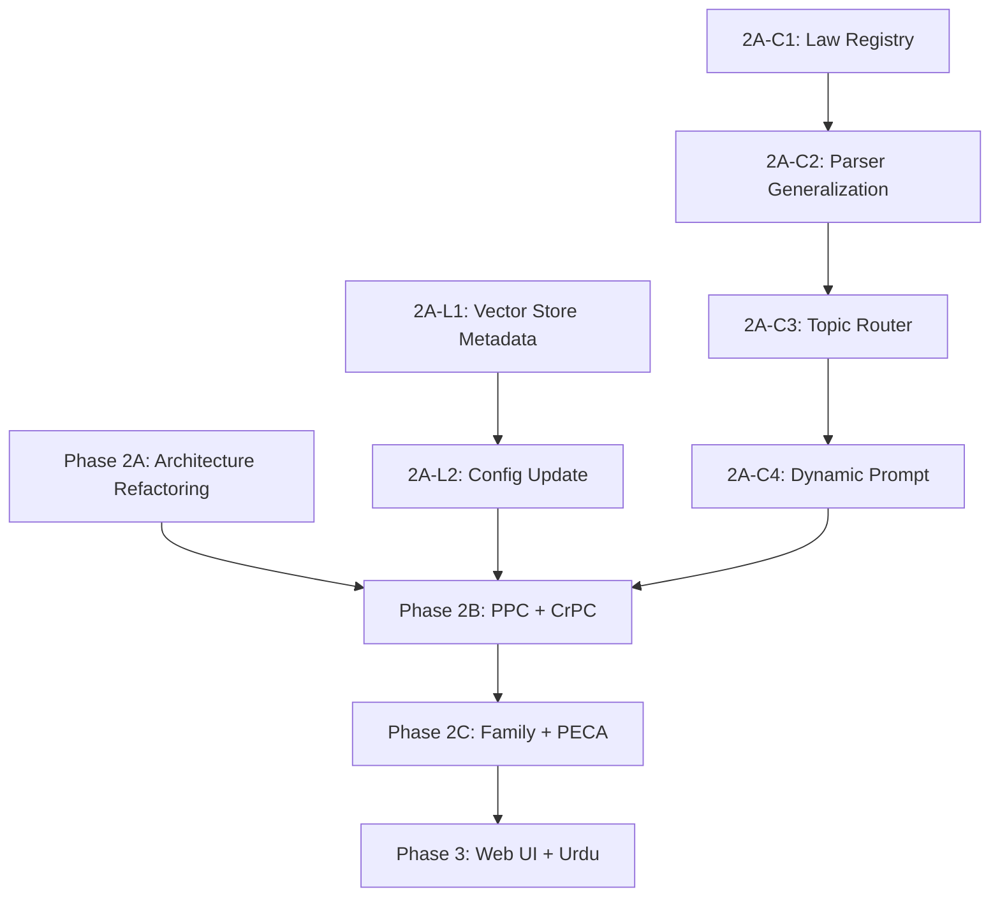

# Phase 2: Expanding Pakistan Law Bot to All Major Pakistani Laws

> [!IMPORTANT]
> The proof-of-concept is **validated** — 100% citation precision, 100% refusal accuracy on Punjab Tenancy Law. Now we evolve from a single-law demo into a comprehensive Pakistani legal information platform.

---

## What Needs to Change (Architecture Gap Analysis)

The current system is hardcoded for **one law** in several places. Here's every point that needs refactoring:

| Component | Current (Single-Law) | Needed (Multi-Law) |
|---|---|---|
| **Parser** | Reads only `data/raw/tenancy_punjab/` | Must scan all `data/raw/<category>/` folders |
| **Scope Detection** | Binary: "tenancy" → in-scope, else → refuse | **Topic Router**: detect WHICH law domain → retrieve from that domain |
| **System Prompt** | Hardcoded to "Punjab Rented Premises Act, 2009" | Dynamic: adapts citation format based on which Act(s) were retrieved |
| **Disclaimer** | Hardcoded to one Act | Dynamic: lists whichever Acts were cited in the answer |
| **Vector Store** | Single collection, no filtering | Single collection with `law_category` metadata filter for targeted retrieval |
| **Config** | Single `COLLECTION_NAME` | Registry of all loaded law categories |
| **Benchmark** | 10 questions for one law | Expanded: per-law test suites |

---

## Priority Laws to Add (Ranked by Citizen Impact)

Based on what ordinary Pakistani citizens most commonly need:

| Priority | Law | Why Citizens Need It | Sections |
|---|---|---|---|
| 🔴 **P1** | **Pakistan Penal Code (PPC), 1860** | Criminal complaints, FIRs, theft, assault, defamation, fraud — the most commonly referenced law | ~500+ |
| 🔴 **P1** | **Code of Criminal Procedure (CrPC), 1898** | How to file FIR, bail, arrest procedures, trial process | ~550+ |
| 🟡 **P2** | **Muslim Family Laws Ordinance, 1961** | Marriage registration, divorce (Talaq/Khula), maintenance, inheritance | ~15 |
| 🟡 **P2** | **Family Courts Act, 1964** | Where and how to file family cases, jurisdiction, procedure | ~20 |
| 🟡 **P2** | **Prevention of Electronic Crimes Act (PECA), 2016** | Cybercrime reporting, online harassment, data theft | ~50 |
| 🟢 **P3** | **Consumer Protection laws** | Product complaints, refunds, deceptive practices | ~60 |
| 🟢 **P3** | **Labour laws** (Shops & Establishments, Industrial Relations) | Employee rights, wages, wrongful termination | ~100 |
| 🟢 **P3** | **Transfer of Property Act, 1882** | Property sale/purchase, registration, disputes | ~130 |

> [!TIP]
> **Start with P1 laws** (PPC + CrPC) — they unlock the most citizen value and are the queries currently being *refused* by the bot.

---

## Architecture Refactoring Plan

### 2.1 — Multi-Law Data Pipeline

```text
data/
├── raw/
│   ├── tenancy_punjab/                    # ✅ Already done
│   │   └── punjab_rented_premises_act_2009.txt
│   ├── criminal/                          # NEW
│   │   ├── pakistan_penal_code_1860.txt
│   │   └── code_of_criminal_procedure_1898.txt
│   ├── family/                            # NEW
│   │   ├── muslim_family_laws_ordinance_1961.txt
│   │   └── family_courts_act_1964.txt
│   ├── cybercrime/                        # NEW
│   │   └── peca_2016.txt
│   └── consumer/                          # NEW
│       └── punjab_consumer_protection_act_2005.txt
├── processed/
│   └── chunks.json                        # Now contains ALL laws' chunks
└── chroma_db/                             # Single DB, metadata-filtered
```

**Key design decision**: One ChromaDB collection with a `law_category` metadata field, NOT separate collections per law. This allows:
- Cross-law queries ("What happens if my landlord assaults me?" → retrieves from both PPC and Tenancy Act)
- Simpler indexing pipeline
- Metadata filtering when you want domain-specific retrieval

### 2.2 — Law Registry (New: `src/law_registry.py`)

A central registry that maps each law to its metadata and parser configuration:

```python
LAW_REGISTRY = {
    "tenancy_punjab": {
        "category": "tenancy",
        "title": "The Punjab Rented Premises Act, 2009",
        "short_title": "Punjab Rented Premises Act",
        "year": 2009,
        "jurisdiction": "Punjab",
        "section_pattern": r"^Section\s+(\d+[A-Za-z]?)\.\s*(.*)",  # Current pattern
        "data_dir": "tenancy_punjab",
        "keywords": ["tenant", "landlord", "rent", "evict", "tenancy", "lease",
                      "rented premises", "security deposit", "rent tribunal"],
    },
    "ppc": {
        "category": "criminal",
        "title": "The Pakistan Penal Code, 1860",
        "short_title": "Pakistan Penal Code",
        "year": 1860,
        "jurisdiction": "Federal",
        "section_pattern": r"^(\d+[A-Z]?)\.\s*(.*)",  # PPC uses "302. Murder" format
        "data_dir": "criminal",
        "keywords": ["FIR", "police", "theft", "murder", "assault", "fraud",
                      "criminal", "bail", "arrest", "punishment", "offence"],
    },
    "crpc": {
        "category": "criminal",
        "title": "The Code of Criminal Procedure, 1898",
        "short_title": "CrPC",
        "year": 1898,
        "jurisdiction": "Federal",
        "section_pattern": r"^(\d+[A-Z]?)\.\s*(.*)",
        "data_dir": "criminal",
        "keywords": ["FIR", "bail", "arrest", "trial", "warrant", "summons",
                      "investigation", "magistrate", "sessions court"],
    },
    # ... more laws added as flat entries
}
```

### 2.3 — Smart Topic Router (Replaces Binary Scope Detection)

The current `detect_scope()` does binary classification: tenancy → in, else → refuse.

The new **Topic Router** does multi-class classification:

```
User Question → Topic Router → [criminal, family, tenancy, cybercrime, unknown]
                                       ↓
                              Metadata filter on vector store query
                                       ↓
                              Retrieve chunks from the right law(s)
```

**Implementation approach**:
1. **Keyword-based first pass** — Use the `keywords` list from the law registry to score each category. Fast, no API cost.
2. **If ambiguous** — Query the vector store WITHOUT filtering and let the embedding similarity decide which law's chunks are most relevant.
3. **If no law matches at all** — Return a helpful refusal explaining which legal topics ARE covered.

### 2.4 — Dynamic System Prompt

Instead of hardcoding "Punjab Rented Premises Act", the system prompt adapts based on what was retrieved:

```python
SYSTEM_PROMPT = """You are a Pakistani Legal Information Specialist.
Your role is to provide accurate legal information based EXCLUSIVELY 
on the statutory provisions provided below.

## LAWS IN CONTEXT:
{laws_in_context}  # ← Dynamically lists which Acts were retrieved

## YOUR RULES:
### RULE 1 — STRICT CITATION
Every factual legal statement must cite: [Act Name - Section X]
...
"""
```

### 2.5 — Parser Refactoring

The current parser already works well but needs:
1. **Configurable section patterns** — PPC uses `302. Murder` not `Section 302. Murder`
2. **Multi-file scanning** — Walk all subdirectories of `data/raw/`
3. **Law-specific chunking strategies** — PPC sections are short (1-3 sentences), so they can be grouped. CrPC sections are longer.

---

## Implementation Phases & Task Breakdown

### Phase 2A: Multi-Law Architecture Refactoring (Critical)

These changes must happen BEFORE adding new laws:

| # | Task | Type | Description |
|---|---|---|---|
| **2A-C1** | Law Registry | 🔴 Critical | Create `src/law_registry.py` with the registry data structure and lookup functions |
| **2A-C2** | Parser Generalization | 🔴 Critical | Refactor `src/parser.py` to accept configurable section patterns from the registry, scan all `data/raw/` subdirs |
| **2A-C3** | Topic Router | 🔴 Critical | Replace binary `detect_scope()` with multi-class topic routing in `src/generator.py` |
| **2A-C4** | Dynamic Prompt | 🔴 Critical | Refactor `SYSTEM_PROMPT` and `LEGAL_DISCLAIMER` to be dynamic based on retrieved chunks |
| **2A-L1** | Vector Store Metadata | 🟢 Less Critical | Add `law_category` field to chunk metadata; add optional `where` filter to `query()` |
| **2A-L2** | Config Update | 🟢 Less Critical | Update `src/config.py` with new paths and settings |

### Phase 2B: First Law Expansion (PPC + CrPC)

| # | Task | Type | Description |
|---|---|---|---|
| **2B-C1** | PPC Data Prep | 🔴 Critical | Acquire clean PPC text, validate section boundary detection, handle PPC's unique formatting |
| **2B-C2** | CrPC Data Prep | 🔴 Critical | Acquire clean CrPC text, handle its Part/Chapter/Section hierarchy |
| **2B-C3** | Criminal Law Benchmark | 🔴 Critical | Create 10+ benchmark questions for PPC/CrPC with ground-truth citations |
| **2B-L1** | Index Rebuild | 🟢 Less Critical | Rebuild the full index with all laws |
| **2B-L2** | README Update | 🟢 Less Critical | Update README to list supported laws |

### Phase 2C: Family Law & PECA

| # | Task | Type | Description |
|---|---|---|---|
| **2C-C1** | Family Law Data & Parsing | 🔴 Critical | Muslim Family Laws Ordinance + Family Courts Act |
| **2C-C2** | PECA Data & Parsing | 🔴 Critical | Prevention of Electronic Crimes Act, 2016 |
| **2C-C3** | Family + PECA Benchmarks | 🔴 Critical | Ground-truth test questions for these domains |
| **2C-L1** | Expanded Scope Docs | 🟢 Less Critical | Document new coverage in README |

### Phase 3: User Experience (After Multi-Law Works)

| # | Task | Description |
|---|---|---|
| **3-1** | **Web Interface** | Streamlit or Flask web UI with chat-style interface |
| **3-2** | **Urdu/Roman Urdu** | Translate scope detection keywords, support Urdu input → English retrieval |
| **3-3** | **Conversation Memory** | Track previous questions in a session for follow-up context |
| **3-4** | **WhatsApp Bot** | Integrate via Twilio or WhatsApp Business API |
| **3-5** | **Response Caching** | Cache frequent questions to reduce API calls |

---

## Recommended Execution Order



**Concrete steps:**
```
Step 1:  2A-L2 (Config Update)              → Other model
Step 2:  2A-L1 (Vector Store Metadata)      → Other model  
Step 3:  2A-C1 (Law Registry)               → Critical (Claude Opus)
Step 4:  2A-C2 (Parser Generalization)      → Critical (Claude Opus)
Step 5:  2A-C3 (Topic Router)               → Critical (Claude Opus)
Step 6:  2A-C4 (Dynamic Prompt)             → Critical (Claude Opus)
Step 7:  Verify all existing tests still pass (regression)
Step 8:  2B-C1 (PPC Data)                   → Critical
Step 9:  2B-C2 (CrPC Data)                  → Critical
Step 10: 2B-C3 (Criminal Benchmarks)        → Critical
Step 11: 2B-L1 (Index Rebuild)              → Other model
Step 12: Full benchmark run (all laws)
```

---

## Data Acquisition Strategy

Getting clean statutory text is the biggest bottleneck. Options ranked by quality:

| Source | Quality | Effort | Notes |
|---|---|---|---|
| **Punjab Laws website** (`punjabcode.punjab.gov.pk`) | ⭐⭐⭐⭐⭐ | Medium | Official, but requires manual copy-paste or scraping |
| **Pakistan Code** (`pakistancode.gov.pk`) | ⭐⭐⭐⭐⭐ | Medium | Official federal laws portal |
| **LawJustia / PakistanLawSite** | ⭐⭐⭐⭐ | Low | Aggregator sites with clean text |
| **PDF → Text extraction** | ⭐⭐⭐ | High | Many laws only available as scanned PDFs — needs OCR |
| **Manual typing** | ⭐⭐⭐⭐⭐ | Very High | Last resort but guarantees accuracy |

> [!WARNING]
> **PPC and CrPC are MASSIVE** (500+ sections each). Unlike the 25-section Tenancy Act, these laws will produce 800+ chunks. This is still well within ChromaDB's capability, but:
> - Embedding + indexing will take 5-10 minutes instead of seconds
> - The topic router becomes more important (can't retrieve from 800 chunks without filtering)
> - Chunk quality matters more — bad splits in PPC mean wrong punishments cited

---

## Key Architectural Decisions to Make

> [!IMPORTANT]
> Before starting implementation, we should align on these:

### Decision 1: One collection vs. multiple collections?
- **Recommended: One collection** with `law_category` metadata filtering
- Simpler code, allows cross-law queries, ChromaDB handles it well

### Decision 2: How to handle laws with different section formats?
- PPC: `302. Punishment for murder` (number-dot format)
- CrPC: `Section 154. Information in cognizable cases` (Section-number format)  
- Family Laws: Short ordinance with numbered clauses
- **Recommended: Configurable regex per law** in the law registry

### Decision 3: Should topic routing use LLM or stay keyword-based?
- **Recommended: Keyword-based first** (free, fast, no API cost)
- Fall back to embedding similarity when keywords are ambiguous
- Only use LLM routing in Phase 3 if needed

### Decision 4: Web framework for the UI?
- **Streamlit**: Fastest to build, built-in chat UI, good for prototyping
- **Flask + vanilla HTML/JS**: More control, looks more professional
- **Gradio**: Easy but limited customization

---

## Estimated Effort

| Phase | Estimated Time | Dependencies |
|---|---|---|
| **2A: Architecture Refactoring** | 2-3 sessions | None |
| **2B: PPC + CrPC** | 2-3 sessions | 2A complete + clean law text files |
| **2C: Family + PECA** | 1-2 sessions | 2A complete + clean law text files |
| **3: Web UI** | 1-2 sessions | 2B complete |
| **3: Urdu Support** | 1-2 sessions | 2B complete |

> [!NOTE]
> The biggest time sink will be **acquiring clean statutory text** for PPC and CrPC. The actual code changes are well-scoped because the current architecture is already modular.
