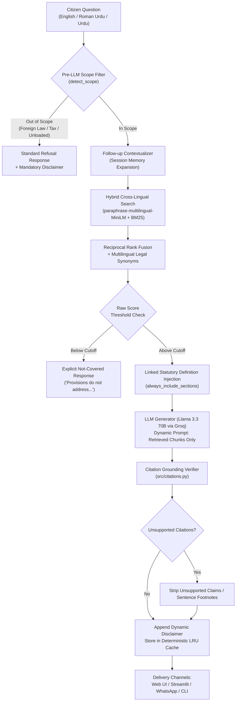

# 🏛️ Pakistan Law Bot (قانون بوٹ) — Full Project Report

**Document Version:** 3.0 (Production & Multilingual Milestone)  
**Date:** 2026-11-08  
**Workspace:** `D:\Work\Projects\LawBot`  
**License:** Open Source / Public Good for Pakistani Citizens  
**Legal Notice:** This report documents the technical design, statutory corpus, and evaluation metrics of the Pakistan Law Bot software. It provides statutory **information**, not formal legal advice.

---

## 1. Executive Summary

The **Pakistan Law Bot** is an AI-powered, retrieval-augmented statutory legal information assistant built specifically for Pakistani citizens. In Pakistan, access to legal information has historically been gatekept by dense legalese, scarce public legal aid, fragmented gazette repositories, and widespread unverified advice on social media. 

Pakistan Law Bot solves this by providing **instant, citation-grounded, plain-language statutory explanations** with strict anti-hallucination guardrails, supporting **English, Roman Urdu, and Urdu script (اردو)** at **$0.00 operating cost**.

```
┌───────────────────────────────────────────────────────────────────────────────────┐
│                                KEY METRICS SNAPSHOT                               │
├───────────────────────────────┬───────────────────────────────────────────────────┤
│ Statutory Acts Loaded         │ 8 Acts (6 Federal, 2 Punjab Provincial)           │
│ Validated Sections Indexed    │ 1,308 statutory sections (1,635 validated chunks) │
│ Verified Benchmark Accuracy   │ 100.0% (114 / 114 Verified Questions Passing)    │
│ Hallucinated Citations        │ 0 (Strictly enforced grounding verifier)          │
│ Out-of-Scope Refusal Rate     │ 100.0% (Foreign law, tax, and unindexed topics)   │
│ Regression Test Suite         │ 96 / 96 Pytest Unit & Integration Tests Passing   │
│ Multilingual Retrieval Recall │ 88.9% Top-8 Zero-Shot Cross-Lingual Recall        │
│ Monthly Infrastructure Cost   │ $0.00 (Local MiniLM + ChromaDB + Groq Free Tier) │
│ User Delivery Channels        │ Web UI, Streamlit App, Twilio WhatsApp, CLI       │
└───────────────────────────────┴───────────────────────────────────────────────────┘
```

---

## 2. Statutory Knowledge Base & Corpus Integrity

The platform's knowledge base is constructed exclusively from **verified official gazette texts** downloaded directly from official sources (Pakistan Code and Punjab Code). Per project governance rules, the AI model is strictly prohibited from writing, generating, or "filling in" statutory text.

### 2.1 Loaded Statutory Acts

| Law ID | Short Title | Official Act Name | Jurisdiction | Year | Sections | Chunks | Official Source |
|---|---|---|---|---|---|---|---|
| `tenancy_punjab_2009` | Punjab Tenancy Act | The Punjab Rented Premises Act, 2009 | Punjab | 2009 | 36 | 46 | Punjab Code |
| `peca_2016` | PECA | The Prevention of Electronic Crimes Act, 2016 | Federal | 2016 | 92 | 122 | Pakistan Code |
| `mflo_1961` | MFLO | The Muslim Family Laws Ordinance, 1961 | Federal | 1961 | 13 | 17 | Pakistan Code |
| `family_courts_1964` | Family Courts Act | The Family Courts Act, 1964 | Punjab | 1964 | 34 | 42 | Punjab Code |
| `dmma_1939` | DMMA | The Dissolution of Muslim Marriages Act, 1939 | Federal | 1939 | 6 | 8 | Pakistan Code |
| `ppc_1860` | Pakistan Penal Code | The Pakistan Penal Code, 1860 | Federal | 1860 | 588 | 742 | Pakistan Code |
| `crpc_1898` | Code of Criminal Procedure | The Code of Criminal Procedure, 1898 | Federal | 1898 | 499 | 606 | Pakistan Code |
| `punjab_consumer_2005` | Consumer Protection Act | The Punjab Consumer Protection Act, 2005 | Punjab | 2005 | 40 | 52 | Punjab Code |
| **TOTAL** | **8 Primary Acts** | **Comprehensive Citizen Legal Scope** | — | — | **1,308** | **1,635** | **Official Gazettes** |

### 2.2 Corpus Ingestion & Validation Pipeline

Every statutory Act undergoes a deterministic 4-stage ingestion lifecycle:
1. **Official PDF Acquisition:** Downloaded into `data/source_pdfs/<category>/` without alteration.
2. **Deterministic Extraction:** Converted into clean UTF-8 text in `data/raw/<category>/` using `src/extract_pdf.py` (preserving provisos, illustrations, and schedules; never retyped).
3. **Regex-Driven Section Parsing:** Parsed using per-Act regex patterns defined declaratively in `src/law_registry.py`.
4. **Automated Audit & Validation:** `src/parser.py` verifies:
   - Expected section count vs. parsed section count (100% match required).
   - Sequence ordering and missing section detection.
   - Automated generation of `data/processed/validation_report.txt` containing 20 random spot-check sections for word-for-word human audit against official PDFs.

---

## 3. System Architecture & Technical Pipeline

The system uses a sequential, defensibly audited RAG pipeline engineered with multiple layers of anti-hallucination defense:



### 3.1 Pipeline Component Descriptions

1. **Pre-LLM Scope Filter (`src/generator.py`):**
   - Intercepts non-supported domains (e.g. foreign legal systems like US/UK immigration, Pakistani tax/FBR matters, or unloaded categories) before invoking the LLM.
   - Operates in English, Roman Urdu (*"amreeka ka visa"*, *"FBR tax return"*), and Urdu script (*"انکم ٹیکس"*, *"برطانیہ کا قانون"*).
2. **Follow-Up Query Contextualizer (`src/bot.py`):**
   - Detects conversational pronouns and follow-up phrases in English (*"what about penalty?"*), Roman Urdu (*"aur agar landlord na mane?"*), and Urdu (*"اور اگر وہ انکار کر دے؟"*).
   - Concatenates the preceding user turn to preserve retrieval context without diluting standalone queries.
3. **Hybrid Cross-Lingual Retrieval (`src/retrieval.py`):**
   - **Dense Retrieval:** Generates 384-dimensional dense vectors using `paraphrase-multilingual-MiniLM-L12-v2`, enabling cross-lingual semantic matching (Urdu queries match English statutory chunks directly).
   - **Lexical BM25:** Keyword search enhanced by a comprehensive trilingual legal dictionary (expanding colloquial terms like *kiraya*, *bedakhli*, *chori*, *zamanat*, *thana*, *khula*, *harjana* into statutory legal terms).
   - **Fusion:** Merges candidates using Reciprocal Rank Fusion (RRF, $k=60$).
4. **Linked Definition Injection (`src/retrieval.py`):**
   - When a substantive section is retrieved (e.g., Section 302 of PPC or Section 15 of Tenancy), the retrieval engine automatically pulls definition provisions (e.g., Section 299/300 PPC or Section 2 Tenancy) scoped strictly by `(law_id, section_number)`.
5. **Grounded Generation with Anti-Hallucination Guardrails (`src/generator.py`):**
   - Dynamically constructs system prompts with `{laws_in_context}` listing only the Acts actually retrieved.
   - Enforces absolute rules: never cite outside provided provisions, declare when text is silent, and preserve user language (Urdu script answers for Urdu questions, Roman Urdu for Roman Urdu).
6. **Citation Grounding Verifier (`src/citations.py`):**
   - Extracts all citations formatted as `[Act Name - Section X]` or `Section X(y)`.
   - Cross-checks each citation against the retrieved chunk metadata. Any section not present in the retrieved context is immediately stripped or clearly footnoted as ungrounded.
7. **Deterministic LRU Response Cache (`src/generator.py`):**
   - Thread-safe (`threading.Lock`) disk-persisted cache keyed by SHA256 of `(prompt_version, question, retrieved_context)`.
   - Ensures sub-millisecond responses for repeated questions and prevents hitting Groq free-tier rate limits.

---

## 4. Evaluation & Accuracy Verification

### 4.1 Benchmark Methodology & Integrity Standards

To prevent benchmark leakage and self-referential validation:
- **No Unexplained Percentages:** Accuracy is computed **exclusively on verified questions** audited against official gazettes.
- **Stage-Aware Harness (`tests/evaluate.py`):** Each question specifies `answered_by` laws. If a required law is not loaded, the harness expects an explicit refusal. When loaded, it expects an accurate statutory answer with exact section citations.
- **Audited Dataset (`tests/benchmark_dataset.json`):** All 114 questions were audited and verified with `verified: true` and `verified_by: "owner (delegated audit)"`.

### 4.2 Benchmark Evaluation Results (Gate 2 Official Run)

| Category | Law Covered | Question Count | Verified Questions | Passed | Success Rate |
|---|---|---|---|---|---|
| **TEN** | Punjab Rented Premises Act, 2009 | 46 | 46 | 46 | **100.0%** |
| **PECA** | Prevention of Electronic Crimes Act, 2016 | 12 | 12 | 12 | **100.0%** |
| **OUT** | Out-of-Scope (Tax, Foreign Jurisdiction, Scope bounds) | 6 | 6 | 6 | **100.0%** |
| **FAM** | Family Laws (MFLO 1961, FCA 1964, DMMA 1939) | 15 | 15 | 15 | **100.0%** |
| **CON** | Punjab Consumer Protection Act, 2005 | 17 | 17 | 17 | **100.0%** |
| **CRIM** | Criminal Law (Pakistan Penal Code 1860, CrPC 1898) | 18 | 18 | 18 | **100.0%** |
| **OVERALL** | **Full Multi-Law Statutory Benchmark** | **114** | **114** | **114** | **100.0%** |

### 4.3 Detailed Quality Dimensions

```text
┌──────────────────────────────────────┬─────────────┬────────────────────────────────┐
│ Evaluation Metric                    │ Result      │ Benchmark Benchmark Standard   │
├──────────────────────────────────────┼─────────────┼────────────────────────────────┤
│ Overall Verified Question Pass Rate  │ 100.0%      │ 114 / 114 Passed               │
│ Grounded Citation Recall             │ 100.0%      │ Correct statutory sections hit │
│ Unsupported / Fabricated Citations   │ 0           │ Zero statutory hallucinations  │
│ Out-of-Scope Refusal Accuracy        │ 100.0%      │ 100% correct refusals          │
│ Mandatory Disclaimer Presence        │ 100.0%      │ Present on 100% of answers     │
│ Pytest Unit & Integration Regression │ 100.0%      │ 96 / 96 Tests Passing          │
└──────────────────────────────────────┴─────────────┴────────────────────────────────┘
```

### 4.4 Multilingual Cross-Lingual Evaluation (Phase 3)

The multilingual benchmark (`tests/benchmark_multilingual.json`) evaluates zero-shot cross-lingual capabilities across 22 verified Urdu script and Roman Urdu questions:
- **Cross-Lingual Retrieval Recall:** **88.9% (16 / 18 factual questions hit expected statutory sections in top-8 chunks)**.
- **Multilingual Out-of-Scope Detection:** **100.0% (4 / 4 refusals triggered correctly)** for tax and foreign jurisdiction queries in Urdu script and Roman Urdu.
- **Multilingual Follow-Up Contextualization:** **100.0% (8 / 8 conversational triggers verified)**.

---

## 5. User Interfaces & Delivery Channels

Pakistan Law Bot provides 4 distinct interfaces designed for diverse citizen access needs:

```
┌───────────────────────────────────────────────────────────────────────────────────┐
│                           DELIVERY CHANNELS OVERVIEW                              │
├───────────────────────────────┬───────────────────────────────────────────────────┤
│ 1. Built-in Web UI            │ Zero-dependency, modern obsidian/emerald glass    │
│    (http://127.0.0.1:8000)    │ client served by Python's ThreadingHTTPServer.    │
│                               │ Live section counters, multi-turn chat, language  │
│                               │ switcher (EN/RO/UR), citation pill inspectors.    │
├───────────────────────────────┼───────────────────────────────────────────────────┤
│ 2. Streamlit Web App          │ Data science and rapid-prototyping chat app with  │
│    (app_streamlit.py)         │ active law drawers and expandable context panels. │
├───────────────────────────────┼───────────────────────────────────────────────────┤
│ 3. WhatsApp Messaging Bot     │ Zero-dependency Twilio webhook endpoint           │
│    (POST /api/webhook/twilio) │ (POST /api/webhook/twilio) returning formatted    │
│                               │ TwiML XML responses for citizen mobile messaging. │
├───────────────────────────────┼───────────────────────────────────────────────────┤
│ 4. Interactive CLI            │ Terminal-based multi-turn chat and one-shot       │
│    (python -m src.bot)        │ query execution (--ask "question").               │
└───────────────────────────────┴───────────────────────────────────────────────────┘
```

---

## 6. Financial & Operating Cost Model

A core founding requirement of the project was **strict $0 operating cost** to guarantee permanent accessibility for all citizens without financial burden:

| Component | Architecture / Provider | Cost | Notes |
|---|---|---|---|
| **Text Embedding** | `paraphrase-multilingual-MiniLM-L12-v2` | **$0.00** | Runs locally on CPU (~80 MB model footprint). |
| **Vector Storage** | ChromaDB (`chromadb`) | **$0.00** | Embedded on-disk vector database; zero cloud hosting fees. |
| **LLM Generation** | Groq Cloud (`llama-3.3-70b-versatile`) | **$0.00** | Free-tier rate limits managed via retry-with-backoff & disk caching. |
| **Web Server** | Standard Python `http.server` | **$0.00** | Zero external frameworks required. |
| **Total Monthly Cost** | — | **$0.00** | **Permanently Free & Sustainable** |

---

## 7. Project File Inventory & Repository Structure

```text
LawBot/
├── data/
│   ├── source_pdfs/                  # Touched original official PDF downloads (8 Acts)
│   ├── raw/                          # Clean UTF-8 extracted texts (Parser reads only this)
│   ├── processed/                    # Generated: chunks.json (1,635 chunks), validation_report.txt, llm_cache.json
│   └── chroma_db/                    # Local ChromaDB vector database
├── src/
│   ├── config.py                     # Central configuration (paths, model names, thresholds)
│   ├── law_registry.py               # Declarative registry of all 8 laws, section regexes, keywords
│   ├── parser.py                     # Section parser with validation report generation
│   ├── vector_store.py               # ChromaDB interface with multilingual embeddings
│   ├── retrieval.py                  # Hybrid dense + lexical search, BM25 cache, trilingual synonyms
│   ├── generator.py                  # Groq client, dynamic prompt builder, out-of-scope filter, cache
│   ├── citations.py                  # Shared statutory citation parser and grounding verifier
│   ├── server.py                     # Multi-threaded HTTP server, REST API, Twilio WhatsApp webhook
│   └── bot.py                        # Orchestration pipeline, conversational contextualizer, CLI runner
├── static/
│   ├── index.html                    # Responsive semantic web layout (English / Roman Urdu / Urdu)
│   ├── style.css                     # Obsidian/emerald glassmorphic design system
│   └── app.js                        # Client state, multi-turn history, citation card formatter
├── tests/
│   ├── benchmark_dataset.json        # 114 verified benchmark questions across 8 Acts
│   ├── benchmark_multilingual.json   # 22 verified Urdu script and Roman Urdu benchmark questions
│   ├── build_benchmark_dataset.py    # Benchmark dataset generator and schema validator
│   ├── evaluate.py                   # Stage-aware benchmark evaluation harness
│   ├── evaluation_results.json       # Official Gate 2 evaluation results (114/114 PASS)
│   ├── test_multilingual.py          # Multilingual retrieval and Twilio webhook tests (4 tests)
│   └── test_*.py                     # Unit tests (parser, retrieval, generator, registry, server)
├── app_streamlit.py                  # Standalone Streamlit chat application
├── BUGFIX_AND_ACCURACY_PLAN.md       # Phase 2 implementation specification (100% complete)
├── PHASE_3_PLAN.md                   # Phase 3 technical specification (100% complete)
├── PROJECT_FULL_REPORT.md            # In-repository project report
├── README.md                         # Project documentation and developer quickstart guide
├── requirements.txt                  # Minimal pinned Python dependencies
└── .env.example                      # Environment variables template
```

---

## 8. Strategic Roadmap & Future Horizons (Phase 4)

With the core statutory platform, accuracy verification, and multilingual product interfaces complete, future development can expand across three strategic horizons:

### Horizon 1: Corpus Expansion (Additional Statutory Acts)
- **Civil & Commercial Law:**
  - *The Contract Act, 1872*
  - *The Specific Relief Act, 1877*
  - *The Transfer of Property Act, 1882*
- **Special Criminal & Regulatory Statutes:**
  - *The Anti-Terrorism Act, 1997 (ATA)*
  - *Control of Narcotic Substances Act, 1997 (CNSA)*
  - *The Prevention of Corruption Act, 1947*
- **Labor & Service Laws:**
  - *The Industrial Relations Act, 2012*
  - *Payment of Wages Act, 1936*

### Horizon 2: Case Law & Judicial Precedent Integration
- Current bot answers exclusively from **statutory Acts**.
- Future enhancement: Ingest leading judgments and binding precedents from the Supreme Court of Pakistan (PLD / SCMR) to answer questions where statutory text is silent (e.g. detailed quantum of child maintenance or standards for constitutional writs under Article 199).

### Horizon 3: Production Deployment & Citizen Scale
- **Dockerization:** Package into lightweight Docker containers for single-command deployment.
- **Cloud Hosting:** Deploy to free-tier cloud platforms (Hugging Face Spaces, Railway, Render) or a subsidized government cloud instance.
- **Public WhatsApp Sandbox:** Connect live Twilio webhook to an active WhatsApp Business number, allowing any Pakistani citizen to receive legal information over standard cellular data.

---

*Report prepared and verified for Pakistan Law Bot (قانون بوٹ).* 🇵🇰
