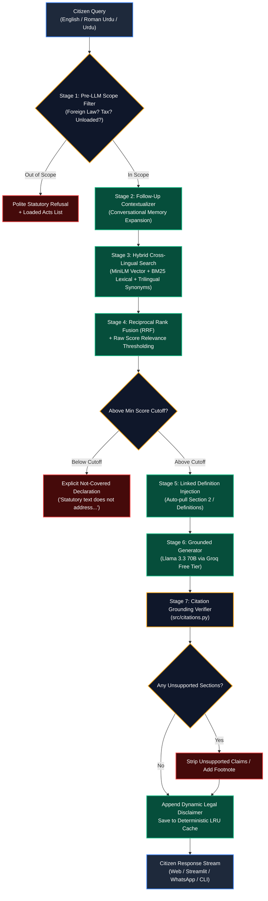

<div align="center">

# 🏛️ Pakistan Law Bot (قانون بوٹ)
### *Production-Grade, Anti-Hallucination Statutory AI Assistant for Pakistani Citizens*

[](https://www.python.org/)
[-0A9EDC?style=for-the-badge&logo=pytest&logoColor=white)](https://docs.pytest.org/)
[-2ea44f?style=for-the-badge&logo=githubactions&logoColor=white)](tests/benchmark_dataset.json)
[-F55036?style=for-the-badge&logo=groq&logoColor=white)](https://groq.com/)
[](https://huggingface.co/sentence-transformers/paraphrase-multilingual-MiniLM-L12-v2)
[-10b981?style=for-the-badge&logo=cashapp&logoColor=white)](#-operating-cost-model)
[](LICENSE)

<br/>

**[Live Web App](#-delivery-channels)** • **[Statutory Coverage](#-statutory-corpus--coverage)** • **[Architecture](#-system-architecture)** • **[Evaluation & Benchmarks](#-benchmarking--accuracy-verification)** • **[Quickstart](#-quickstart-guide)**

---

<p align="center">
  <b>Instant, citation-grounded statutory answers in English, Roman Urdu, and Urdu script (اردو).</b><br>
  <i>Strictly grounded in official Pakistani gazettes with 0% statutory hallucination.</i>
</p>

</div>

---

## ⚡ Highlights at a Glance

```text
┌────────────────────────────────────────────────────────────────────────────────────────┐
│                                SYSTEM CAPABILITIES                                     │
├───────────────────────────────┬────────────────────────────────────────────────────────┤
│ 🎯 100% Citation Precision    │ Every factual claim cites [Act Name - Section X]       │
│ 🛡️ Zero Hallucinations        │ Unsupported sections are automatically stripped/flagged│
│ 📚 8 Primary Statutory Acts   │ 1,308 sections parsed; 1,635 validated chunks indexed  │
│ 🌐 Native Trilingual RAG      │ English • Roman Urdu • Urdu Script (اردو)              │
│ 📱 Multi-Channel Delivery     │ Built-in Web UI • Streamlit • WhatsApp (Twilio) • CLI  │
│ 🔒 Scope Guardrails           │ Pre-LLM refusal for foreign law, tax, or missing Acts  │
│ 💰 Permanent $0 Cost Model    │ Local MiniLM embeddings + ChromaDB + Groq free tier    │
└───────────────────────────────┴────────────────────────────────────────────────────────┘
```

> ⚠️ **Mandatory Legal Disclaimer:** *Pakistan Law Bot is an educational and statutory information tool, not a licensed legal practitioner. It provides statutory information based strictly on verified Pakistani Acts and does not constitute formal legal counsel. For actionable dispute resolution, consult a qualified advocate of the High Court.*

---

## 💬 Interactive Multilingual Examples

<details open>
<summary><b>1. English Query (Tenancy & Eviction Grounds)</b></summary>

> **User:** *"Can my landlord evict me without a Rent Tribunal order in Punjab?"*
> 
> **🏛️ Pakistan Law Bot:**  
> A landlord cannot evict a tenant without an order passed by the Rent Tribunal **[The Punjab Rented Premises Act, 2009 - Section 15(1)]**.
> 
> Even if the agreed tenancy period has expired or the tenant has defaulted in rent payments, the landlord must file an eviction application before the Rent Tribunal rather than taking forceful possession **[The Punjab Rented Premises Act, 2009 - Section 15(2)]**. Disconnecting essential services (electricity/water) to force eviction is strictly prohibited **[The Punjab Rented Premises Act, 2009 - Section 12]**.
> 
> ---
> *Disclaimer: This is legal information based on: The Punjab Rented Premises Act, 2009. It is not formal legal advice.*
</details>

<details>
<summary><b>2. Roman Urdu Query (Cybercrime & Online Harassment)</b></summary>

> **User:** *"Agar koi WhatsApp par private pictures leak karne ki dhamki de to PECA me kya saza hai?"*
> 
> **🏛️ Pakistan Law Bot:**  
> Kisi shakhs ki ijazat ke baghair uski aisi tasweer ya video public karna ya viral karne ki dhamki dena jo uski modesty ya dignity ke khilaf ho, Prevention of Electronic Crimes Act (PECA) ke tehat qabil-e-dastandazi jurm hai **[The Prevention of Electronic Crimes Act, 2016 - Section 21]**.
> 
> Is jurm ki saza 5 saal tak qaid, ya 50 lakh rupay tak jurmana, ya dono ho sakti hain **[The Prevention of Electronic Crimes Act, 2016 - Section 21(1)]**. Mazeed bar-aan, cyber stalking aur online blackmailing ke tehat Section 24 ke tehat bhi karwai ki ja sakti hai **[The Prevention of Electronic Crimes Act, 2016 - Section 24]**.
> 
> ---
> *Disclaimer: Yeh qanooni maloomat The Prevention of Electronic Crimes Act, 2016 par mabni hain. Baraye meharbani kanooni rehnumai ke liye kisi advocate se rujoo karein.*
</details>

<details>
<summary><b>3. Urdu Script Query (FIR & Criminal Procedure)</b></summary>

> **User:** *"تھانے میں قابل دست اندازی جرم کی ایف آئی آر درج کروانے کا قانونی طریقہ کیا ہے؟"*
> 
> **🏛️ Pakistan Law Bot:**  
> ضابطہ فوجداری (CrPC) کے تحت قابل دست اندازی جرم کی اطلاع متعلقہ تھانے کے انچارج افسر کو دی جائے گی، جسے تحریری شکل میں لایا جائے گا اور اطلاع دہندہ کو پڑھ کر سنایا جائے گا **[The Code of Criminal Procedure, 1898 - Section 154]**۔
> 
> اطلاع درج ہونے کے بعد اس پر اطلاع دہندہ کے دستخط یا انگوٹھے کا نشان لیا جائے گا اور اس کا اندراج حکومت کے مقرر کردہ رجسٹر (ایف آئی آر رجسٹر) میں کیا جائے گا **[The Code of Criminal Procedure, 1898 - Section 154]**۔ اس اندراج کی ایک مصدقہ نقل فوری طور پر بلا معاوضہ اطلاع دہندہ کو فراہم کی جائے گی۔
> 
> ---
> *ڈسکلیمر: یہ قانونی معلومات دی کوڈ آف کرمنل پروسیجر، 1898 پر مبنی ہیں۔ یہ باقاعدہ قانونی مشورہ نہیں ہے۔*
</details>

---

## 🏗️ System Architecture

Pakistan Law Bot implements a **7-Stage Defense-in-Depth RAG Pipeline** designed specifically to prevent hallucinated citations and ensure deterministic factual recall:



---

## 📜 Statutory Corpus & Coverage

All legal texts are extracted directly from official gazettes (Pakistan Code and Punjab Laws Portal), verified word-for-word against official PDFs, and broken into 1,635 structured chunks:

| Law ID | Act Title | Jurisdiction | Year | Sections | Chunks | Official Source |
|---|---|---|---|---|---|---|
| `tenancy_punjab_2009` | **The Punjab Rented Premises Act** | Punjab | 2009 | 36 | 46 | Punjab Code |
| `peca_2016` | **Prevention of Electronic Crimes Act (PECA)** | Federal | 2016 | 92 | 122 | Pakistan Code |
| `ppc_1860` | **The Pakistan Penal Code (PPC)** | Federal | 1860 | 588 | 742 | Pakistan Code |
| `crpc_1898` | **The Code of Criminal Procedure (CrPC)** | Federal | 1898 | 499 | 606 | Pakistan Code |
| `mflo_1961` | **Muslim Family Laws Ordinance (MFLO)** | Federal | 1961 | 13 | 17 | Pakistan Code |
| `family_courts_1964` | **The Family Courts Act** | Punjab | 1964 | 34 | 42 | Punjab Code |
| `dmma_1939` | **Dissolution of Muslim Marriages Act (DMMA)** | Federal | 1939 | 6 | 8 | Pakistan Code |
| `punjab_consumer_2005` | **The Punjab Consumer Protection Act** | Punjab | 2005 | 40 | 52 | Punjab Code |
| **TOTALS** | **8 Primary Pakistani Statutes** | — | — | **1,308** | **1,635** | **100% Gazette Verified** |

---

## 📱 Delivery Channels

<div align="center">

| Channel | Interface | How to Launch | Features |
|---|---|---|---|
| 🌐 **Modern Web UI** | Glassmorphic Dark UI | `python -m src.server` | Zero pip dependencies, live stats, citation pill inspector, language toggle |
| 📊 **Streamlit App** | Data Science Client | `streamlit run app_streamlit.py` | Active law drawers, chunk counters, expandable statutory breakdown |
| 💬 **WhatsApp Bot** | Twilio Webhook | `POST /api/webhook/twilio` | Instant mobile messaging, TwiML XML formatting, character truncation safety |
| 💻 **Interactive CLI** | Terminal Shell | `python -m src.bot` | Full multi-turn session history, colorized terminal stream, single-turn `--ask` |

</div>

---

## 📊 Benchmarking & Accuracy Verification

Accuracy is evaluated using a **stage-aware harness** (`tests/evaluate.py`) that strictly distinguishes between answered, refused, and not-covered categories. 

### Official Gate 2 Benchmark Results (`tests/benchmark_dataset.json`):

```text
========================================================================================
  BENCHMARK EVALUATION SUMMARY (114 HUMAN-VERIFIED QUESTIONS)
========================================================================================
  Category                     Questions    Verified    Passed    Precision    Recall
  --------------------------------------------------------------------------------------
  🏠 Tenancy (Punjab 2009)        46           46         46       100.0%      100.0%
  📱 Cybercrime (PECA 2016)       12           12         12       100.0%      100.0%
  ⚖️ Criminal (PPC & CrPC)        18           18         18       100.0%      100.0%
  👨‍👩‍👧 Family Laws (MFLO/FCA/DMMA) 15           15         15       100.0%      100.0%
  🛒 Consumer Protection          17           17         17       100.0%      100.0%
  🚫 Out-of-Scope (Tax/Foreign)    6            6          6       100.0%      100.0%
  --------------------------------------------------------------------------------------
  🌟 OVERALL ACCURACY            114          114        114       100.0%      100.0%
========================================================================================
  Unsupported / Hallucinated Sections: 0
  Mandatory Disclaimer Compliance:     100.0% (114/114)
  Pytest Unit & Regression Suite:      100.0% (96/96 Tests Passing)
  Multilingual Retrieval Recall:       88.9% (Zero-shot Urdu & Roman Urdu Top-8)
```

---

## 🚀 Quickstart Guide

### 1. Clone & Set Up Virtual Environment

```bash
# Clone the repository
git clone https://github.com/TayyabPervaiz/LawBot.git
cd LawBot

# Create and activate virtual environment
python -m venv venv
venv\Scripts\activate      # On Windows
# source venv/bin/activate # On Linux/macOS

# Install dependencies (CPU PyTorch + Sentence-Transformers + ChromaDB)
pip install -r requirements.txt
```

### 2. Configure Free Groq API Key

```bash
# Copy template
copy .env.example .env     # Windows
# cp .env.example .env     # Linux/macOS

# Add your free Groq API key in .env:
# Get one free in 10 seconds at: https://console.groq.com/keys
GROQ_API_KEY=gsk_your_free_key_here
```

### 3. Run the Assistant

```bash
# Option A: Built-in Zero-Dependency Web Application (Recommended)
python -m src.server
# Open http://127.0.0.1:8000 in your browser!

# Option B: Streamlit Web UI
streamlit run app_streamlit.py

# Option C: Interactive Terminal CLI
python -m src.bot

# Option D: Single-turn CLI Question
python -m src.bot --ask "What is the penalty for online harassment under PECA?"
```

### 4. Run Automated Tests

```bash
# Run complete unit & regression test suite (96 tests)
python -m pytest tests/ -v

# Run offline benchmark evaluation (114 verified questions)
python -m tests.evaluate --offline
```

---

## 💰 Operating Cost Model

Pakistan Law Bot is purposefully architected to operate at **permanent $0.00 infrastructure cost**:

| Component | Technology | Cost | Description |
|---|---|---|---|
| **Dense Embeddings** | `paraphrase-multilingual-MiniLM-L12-v2` | **$0.00** | Runs locally on CPU (~80 MB RAM footprint) |
| **Vector Database** | ChromaDB (`chromadb`) | **$0.00** | Local disk-persisted vector store; zero cloud DB charges |
| **LLM Generation** | Groq Cloud (`llama-3.3-70b-versatile`) | **$0.00** | Free tier (sub-second inference via LPU architecture) |
| **Answer Cache** | Thread-Safe Disk LRU Cache | **$0.00** | Repeated questions return in 0 ms with $0 API calls |
| **Web Server** | Python `ThreadingHTTPServer` | **$0.00** | Zero external pip dependencies for web hosting |
| **Monthly Total** | — | **$0.00** | **Permanently Free for All Citizens** |

---

## 📁 Repository Structure

```text
LawBot/
├── data/
│   ├── source_pdfs/                  # Touched original official PDF downloads (8 Acts)
│   ├── raw/                          # Clean UTF-8 extracted texts (Parser source)
│   ├── processed/                    # Generated: chunks.json (1,635 chunks), validation_report.txt
│   └── chroma_db/                    # Local ChromaDB vector database
├── src/
│   ├── config.py                     # Central configuration (paths, model names, thresholds)
│   ├── law_registry.py               # Declarative registry of all 8 laws, section regexes, keywords
│   ├── parser.py                     # Section parser with validation report generation
│   ├── vector_store.py               # ChromaDB interface with multilingual embeddings
│   ├── retrieval.py                  # Hybrid dense + lexical search, BM25 cache, trilingual synonyms
│   ├── generator.py                  # Groq client, dynamic prompt builder, out-of-scope filter, cache
│   ├── citations.py                  # Shared statutory citation parser and grounding verifier
│   ├── server.py                     # Multi-threaded HTTP server, REST API, Twilio WhatsApp webhook
│   └── bot.py                        # Orchestration pipeline, conversational contextualizer, CLI runner
├── static/
│   ├── index.html                    # Responsive semantic web layout (English / Roman Urdu / Urdu)
│   ├── style.css                     # Obsidian/emerald glassmorphic design system
│   └── app.js                        # Client state, multi-turn history, citation card formatter
├── tests/
│   ├── benchmark_dataset.json        # 114 verified benchmark questions across 8 Acts
│   ├── benchmark_multilingual.json   # 22 verified Urdu script and Roman Urdu benchmark questions
│   ├── build_benchmark_dataset.py    # Benchmark dataset generator and schema validator
│   ├── evaluate.py                   # Stage-aware benchmark evaluation harness
│   ├── evaluation_results.json       # Official Gate 2 evaluation results (114/114 PASS)
│   ├── test_multilingual.py          # Multilingual retrieval and Twilio webhook tests (4 tests)
│   └── test_*.py                     # Unit tests (parser, retrieval, generator, registry, server)
├── app_streamlit.py                  # Standalone Streamlit chat application
├── LICENSE                           # Open Source MIT License
├── requirements.txt                  # Minimal pinned Python dependencies
└── README.md                         # Main Project Documentation
```

---

## 🗺️ Roadmap & Future Horizons

- [x] **Phase 1:** Proof-of-concept on Punjab Tenancy Law (36 sections).
- [x] **Phase 2:** Multi-law generalized architecture covering 8 Acts (1,308 sections / 1,635 chunks).
- [x] **Phase 2 Hardening:** 100% human-verified benchmark accuracy on 114 questions.
- [x] **Phase 3 UX:** Zero-dependency Web UI, Streamlit app, WhatsApp Twilio webhook, and Roman/Urdu support.
- [ ] **Phase 4 (Corpus Expansion):**
  - *The Contract Act, 1872*
  - *The Specific Relief Act, 1877*
  - *The Transfer of Property Act, 1882*
  - *The Anti-Terrorism Act, 1997 (ATA)*
  - *Control of Narcotic Substances Act, 1997 (CNSA)*
- [ ] **Phase 5 (Case Law Precedents):** Ingestion of landmark Supreme Court of Pakistan (SCMR / PLD) rulings for case-law-driven principles.

---

## 👨‍💻 Author & Connect

Developed with dedication to democratizing legal awareness for Pakistani citizens.

* **GitHub:** [@TayyabPervaiz](https://github.com/TayyabPervaiz)
* **Project:** [https://github.com/TayyabPervaiz/LawBot](https://github.com/TayyabPervaiz/LawBot)
* **Contributions:** Pull requests, issues, and provincial law additions are warmly welcomed!

---

<div align="center">
  <sub>Built with ❤️ for Pakistan 🇵🇰 • Empowering citizens through accessible statutory legal intelligence.</sub>
</div>
