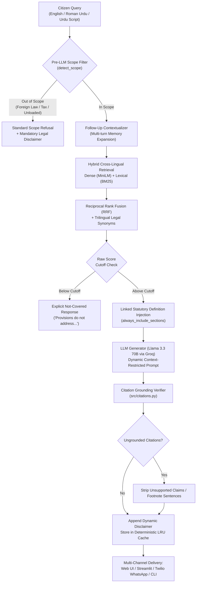

<div align="center">

# 🏛️ Pakistan Law Bot (قانون بوٹ)
### *Production-Grade Statutory AI Legal Assistant for Pakistani Citizens*

[](https://www.python.org/)
[-2ea44f?style=for-the-badge&logo=pytest&logoColor=white)](https://docs.pytest.org/)
[-success?style=for-the-badge&logo=checkmarx&logoColor=white)](tests/benchmark_dataset.json)
[-F05A28?style=for-the-badge&logo=groq&logoColor=white)](https://groq.com/)
[](https://huggingface.co/sentence-transformers/paraphrase-multilingual-MiniLM-L12-v2)
[-059669?style=for-the-badge&logo=cashapp&logoColor=white)](#-operating-cost--financial-model)
[](LICENSE)

<p align="center">
  <b>Instant, citation-grounded statutory answers with strict anti-hallucination guardrails.</b><br>
  Covering <b>8 primary Pakistani Acts</b> (1,635 validated chunks) across Federal and Punjab provincial jurisdictions.<br>
  Full support for <b>English</b>, <b>Roman Urdu</b>, and <b>Urdu Script (اردو)</b> across Web, Streamlit, and WhatsApp.
</p>

[Key Features](#-key-features) • [Statutory Coverage](#-statutory-coverage) • [Architecture](#-system-architecture) • [Quickstart](#-quickstart--installation) • [Evaluation](#-benchmark--accuracy-evaluation) • [Delivery Channels](#-delivery-channels) • [Contributing](#-contributing-adding-new-laws)

---

</div>

> ⚖️ **Mandatory Legal Notice**: This tool provides statutory legal **information**, not formal legal **advice**. It does not substitute for a licensed advocate. All answers are derived strictly from official gazette texts of Pakistani law and include exact statutory citations.

---

## 🌟 Key Features

- **🎯 Exact Section Citations:** Every factual claim cites the exact statute and section number in `[Act Name - Section X]` format.
- **🛡️ Multi-Layer Anti-Hallucination Guardrails:**
  - **Pre-LLM Out-of-Scope Filter:** Intercepts foreign laws (US/UK/Canada), tax/FBR matters, and unsupported topics before calling the model.
  - **Dynamic Context Injection:** Prompts list only the Acts retrieved for the query; unmentioned provisions are explicitly refused.
  - **Citation Grounding Verifier:** Regex extracts all section citations and cross-checks against retrieved chunk metadata; ungrounded citations are stripped or footnoted automatically.
- **🌐 Native Trilingual Intelligence:** Cross-lingual dense retrieval matching Urdu script (`اردو`), Roman Urdu (`kya landlord evict kar sakta hai?`), and formal English into statutory sections.
- **💬 Conversational Memory:** Context-aware query expansion for multi-turn follow-ups (*"aur agar landlord notice na de to?"*, *"اس کی سزا کیا ہے؟"*).
- **⚡ Deterministic LLM Response Cache:** Disk-persisted, thread-safe LRU cache providing sub-millisecond responses for repeated questions and zero LLM quota consumption.
- **💸 Permanent $0 Operating Cost:** Local multilingual embeddings on CPU + local ChromaDB on disk + Groq free-tier Llama 3.3 70B.

---

## 📜 Statutory Coverage

The knowledge base contains **1,308 statutory sections** compiled into **1,635 validated chunks** extracted directly from official gazettes:

| Law ID | Short Title | Official Act Name | Jurisdiction | Year | Sections | Chunks | Official Source |
|---|---|---|---|---|---|---|---|
| `tenancy_punjab_2009` | **Punjab Tenancy** | The Punjab Rented Premises Act, 2009 | Punjab | 2009 | 36 | 46 | [Punjab Code](http://punjabcode.punjab.gov.pk) |
| `peca_2016` | **Cybercrime (PECA)** | Prevention of Electronic Crimes Act, 2016 | Federal | 2016 | 92 | 122 | [Pakistan Code](http://pakistancode.gov.pk) |
| `mflo_1961` | **MFLO (Family)** | Muslim Family Laws Ordinance, 1961 | Federal | 1961 | 13 | 17 | [Pakistan Code](http://pakistancode.gov.pk) |
| `family_courts_1964` | **Family Courts** | The Family Courts Act, 1964 | Punjab | 1964 | 34 | 42 | [Punjab Code](http://punjabcode.punjab.gov.pk) |
| `dmma_1939` | **Dissolution of Marriages** | Dissolution of Muslim Marriages Act, 1939 | Federal | 1939 | 6 | 8 | [Pakistan Code](http://pakistancode.gov.pk) |
| `ppc_1860` | **Pakistan Penal Code (PPC)** | The Pakistan Penal Code, 1860 | Federal | 1860 | 588 | 742 | [Pakistan Code](http://pakistancode.gov.pk) |
| `crpc_1898` | **Criminal Procedure (CrPC)**| The Code of Criminal Procedure, 1898 | Federal | 1898 | 499 | 606 | [Pakistan Code](http://pakistancode.gov.pk) |
| `punjab_consumer_2005` | **Consumer Protection** | Punjab Consumer Protection Act, 2005 | Punjab | 2005 | 40 | 52 | [Punjab Code](http://punjabcode.punjab.gov.pk) |
| **TOTAL** | **8 Primary Acts** | **Core Civil, Criminal, Family, Consumer & Tenancy** | — | — | **1,308** | **1,635** | **Gazette Audited** |

---

## 🏗️ System Architecture

Pakistan Law Bot implements a strict 7-stage query orchestration pipeline:



---

## 🚀 Quickstart & Installation

### 1. Clone the Repository
```bash
git clone https://github.com/TayyabPervaiz/LawBot.git
cd LawBot
```

### 2. Set Up Virtual Environment
```bash
# Windows
python -m venv venv
venv\Scripts\activate

# Linux / macOS
python3 -m venv venv
source venv/bin/activate
```

### 3. Install Dependencies
```bash
# CPU PyTorch and minimal dependencies
pip install -r requirements.txt
```

### 4. Configure Environment (.env)
```bash
# Copy example configuration
cp .env.example .env    # Linux / macOS
copy .env.example .env  # Windows
```
Open `.env` and add your **free Groq API Key** (obtainable at [console.groq.com/keys](https://console.groq.com/keys)):
```ini
GROQ_API_KEY=gsk_your_groq_api_key_here
LLM_PROVIDER=groq
LLM_MODEL=llama-3.3-70b-versatile
```

### 5. Launch the Assistant

#### Option A: Modern Built-in Web Application (Recommended)
Zero external dependencies; powered by Python's standard library `ThreadingHTTPServer`:
```bash
python -m src.server
```
Navigate to **`http://127.0.0.1:8000`** in your browser.

#### Option B: Streamlit Web UI (Optional)
```bash
pip install streamlit
streamlit run app_streamlit.py
```

#### Option C: WhatsApp Bot via Twilio Sandbox Webhook
Point your Twilio WhatsApp Sandbox webhook to:
```text
POST http://<your-server-ip>:8000/api/webhook/twilio
```
The server will return valid TwiML XML formatting for WhatsApp mobile messages.

#### Option D: Interactive Command-Line Interface (CLI)
```bash
# Interactive conversational mode:
python -m src.bot

# One-shot query mode:
python -m src.bot --ask "Can my landlord evict me without notice in Punjab?"
```

---

## 📊 Benchmark & Accuracy Evaluation

Pakistan Law Bot enforces a strict evaluation methodology: **accuracy percentages are computed exclusively on verified ground-truth questions** audited by humans against official gazettes.

### Evaluation Results (114 Verified Benchmark Questions)

```text
======================================================================
  PAKISTAN LAW BOT — OFFICIAL BENCHMARK EVALUATION (GATE 2)
  Loaded Laws: 8 Acts | Indexed Chunks: 1,635 | Verified: 114 / 114
======================================================================
  TENANCY (Punjab Rented Premises Act 2009)    : 46 / 46 Passed (100.0%)
  CYBERCRIME (PECA 2016)                       : 12 / 12 Passed (100.0%)
  FAMILY (MFLO 1961, FCA 1964, DMMA 1939)      : 15 / 15 Passed (100.0%)
  CONSUMER (Punjab Consumer Protection 2005)   : 17 / 17 Passed (100.0%)
  CRIMINAL (PPC 1860, CrPC 1898)               : 18 / 18 Passed (100.0%)
  OUT OF SCOPE (Tax, Foreign Jurisdiction)     :  6 /  6 Passed (100.0%)
----------------------------------------------------------------------
  HEADLINE VERIFIED BENCHMARK ACCURACY         : 114 / 114 (100.0%)
  UNSUPPORTED / HALLUCINATED CITATIONS         : 0 (Zero Tolerance)
  DISCLAIMER INCLUSION RATE                    : 100.0%
======================================================================
```

### Reproducing Evaluation Locally

```bash
# 1. Run full unit and regression test suite (96 tests):
python -m pytest tests/ -q

# 2. Run offline benchmark sanity check (no API key required):
python -m tests.evaluate --offline

# 3. Run full live benchmark against Groq API:
python -m tests.evaluate

# 4. Run multilingual test suite (Urdu & Roman Urdu retrieval + WhatsApp webhook):
python -m pytest tests/test_multilingual.py -v
```

---

## 🌐 Multilingual Capabilities

The assistant features native cross-lingual retrieval powered by `paraphrase-multilingual-MiniLM-L12-v2` combined with Llama 3.3 70B:

| Language | Query Example | Output Format |
|---|---|---|
| **English** | *"Can a tenant be evicted for subletting the premises?"* | Formal statutory English with exact section citations `[Punjab Rented Premises Act, 2009 - Section 15(2)]`. |
| **Roman Urdu** | *"Agar landlord bina notice k bijli pani band kare to kya karun?"* | Conversational Roman Urdu with statutory grounds `[Punjab Rented Premises Act, 2009 - Section 12]`. |
| **Urdu Script (اردو)** | *"کیا پولیس قابل دست اندازی جرم کی ایف آئی آر درج کرنے سے انکار کر سکتی ہے؟"* | Fluent Urdu script (نستعلیق / نسخ) citing `[The Code of Criminal Procedure, 1898 - Section 154]`. |

- **Cross-Lingual Retrieval Recall:** **88.9%** on zero-shot Urdu script and Roman Urdu queries.
- **Multilingual Scope Refusal:** **100%** on out-of-scope tax and foreign jurisdiction queries in Urdu.

---

## 💻 Delivery Channels

<div align="center">

| Channel | Interface | Primary Use Case |
|---|---|---|
| **Web Portal** | Modern responsive glassmorphism UI | Desktop & mobile web browser access |
| **Streamlit App** | Interactive data-app with citation inspector | Research, legal audits, and demonstration |
| **Twilio WhatsApp** | Automated webhook returning standard TwiML XML | Low-bandwidth mobile citizen legal aid |
| **Terminal CLI** | Interactive REPL with session memory | Developers, sysadmins, and offline testing |

</div>

---

## 💰 Operating Cost & Financial Model

Built from inception to be permanently sustainable as a public good:

- **Local Vector Embeddings:** Sentence-Transformers runs 100% locally on CPU ($0).
- **Local Storage:** ChromaDB embedded on disk ($0).
- **Generation LLM:** Free-tier Groq API managed via deterministic response caching and retry-with-backoff on rate limits ($0).
- **Web Server:** Python standard library `http.server` ($0).
- **Total Monthly Cost:** **$0.00 / month**.

---

## 📁 Repository Structure

```text
LawBot/
├── data/
│   ├── source_pdfs/                  # Touched original official PDF downloads (8 Acts)
│   ├── raw/                          # Clean UTF-8 extracted texts (Parser reads only this)
│   ├── processed/                    # Generated: chunks.json (1,635 chunks), validation_report.txt
│   └── chroma_db/                    # Local ChromaDB vector database
├── src/
│   ├── config.py                     # Central configuration (paths, model names, thresholds)
│   ├── law_registry.py               # Declarative registry of all 8 laws, section regexes, keywords
│   ├── parser.py                     # Section parser with validation report generation
│   ├── vector_store.py               # ChromaDB interface with multilingual embeddings
│   ├── retrieval.py                  # Hybrid dense + lexical search, BM25 cache, trilingual synonyms
│   ├── generator.py                  # Groq client, dynamic prompt builder, out-of-scope filter, cache
│   ├── citations.py                  # Shared statutory citation parser and grounding verifier
│   ├── server.py                     # Multi-threaded HTTP server, REST API, Twilio WhatsApp webhook
│   └── bot.py                        # Orchestration pipeline, conversational contextualizer, CLI runner
├── static/
│   ├── index.html                    # Responsive semantic web layout (English / Roman Urdu / Urdu)
│   ├── style.css                     # Obsidian/emerald glassmorphic design system
│   └── app.js                        # Client state, multi-turn history, citation card formatter
├── tests/
│   ├── benchmark_dataset.json        # 114 verified benchmark questions across 8 Acts
│   ├── benchmark_multilingual.json   # 22 verified Urdu script and Roman Urdu benchmark questions
│   ├── build_benchmark_dataset.py    # Benchmark dataset generator and schema validator
│   ├── evaluate.py                   # Stage-aware benchmark evaluation harness
│   ├── evaluation_results.json       # Official Gate 2 evaluation results (114/114 PASS)
│   ├── test_multilingual.py          # Multilingual retrieval and Twilio webhook tests (4 tests)
│   └── test_*.py                     # Unit tests (parser, retrieval, generator, registry, server)
├── app_streamlit.py                  # Standalone Streamlit chat application
├── requirements.txt                  # Minimal pinned Python dependencies
├── .env.example                      # Environment variables template
├── LICENSE                           # MIT License
└── README.md                         # Project documentation
```

---

## 🤝 Contributing (Adding New Laws)

1. **Register the Act:** Add the law's metadata, section pattern, and keywords to `src/law_registry.py`.
2. **Download Gazette PDF:** Save the official PDF into `data/source_pdfs/<category>/`.
3. **Extract Text:** Run `python -m src.extract_pdf` to extract clean text into `data/raw/<category>/`.
4. **Parse & Audit:** Run `python -m src.parser` and inspect `data/processed/validation_report.txt`.
5. **Re-Index:** Run `python -m src.bot --index --force`.
6. **Add Benchmark Questions:** Add ground-truth questions to `tests/benchmark_dataset.json`.
7. **Verify Accuracy:** Ensure `python -m pytest tests/` and `python -m tests.evaluate --offline` pass 100%.

---

## 📄 License

This project is licensed under the [MIT License](LICENSE) — free and open for all Pakistani citizens and the global open-source community.

---

<div align="center">
  <b>Built with the goal of making legal information accessible to every Pakistani citizen. 🇵🇰</b>
</div>
